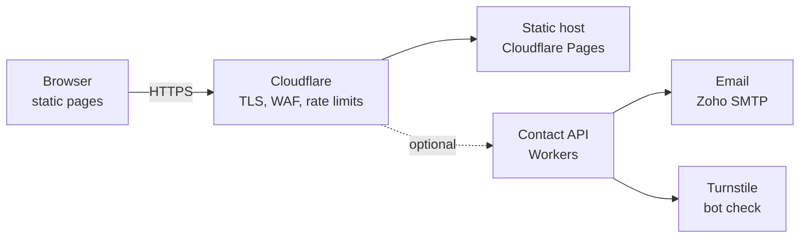

# Zegbit website — front end

A complete, dependency-free front end: plain HTML, one CSS file and one JS file.
Public website only: there are no log-in, account or dashboard pages (team tools live on crew.zegbit.com).
Open `index.html` in a browser, or deploy the folder as-is to any static host.

## Pages

| File | Page | Notes |
|---|---|---|
| `index.html` | Home | Animated Core logo, live node mesh, services, products, process, sample audit |
| `services.html` | Services | Software, Cybersecurity, Networking (anchors `#software`, `#security`, `#network`) + FAQ |
| `work.html` | Work | Sanitised sample report (2 pages in a viewer) + project cards |
| `about.html` | About | Name meaning, logo layers, values, team |
| `products.html` | Products | ZegBit Guard, PDPA Ready and Class (anchors `#guard`, `#pdpa`, `#class`), all marked "In development" |
| `contact.html` | Contact | Quote form (incl. product early access), channels, "what happens next" |
| `security.html` | Responsible disclosure | Policy + `/.well-known/security.txt` (RFC 9116) |
| `legal.html` | Privacy + Terms | Template text — have a lawyer review it (Sri Lanka PDPA No. 9 of 2022) |
| `404.html` | Not found | Point your host's 404 to this file |

```
zegbit-website/
├── *.html
├── assets/
│   ├── site.css                     all styles (tokens at the top)
│   ├── site.js                      menu, animations, contact form
│   ├── favicon.svg
│   └── zegbit-sample-vapt-report.pdf
├── .well-known/security.txt
├── _headers                         security headers (Cloudflare Pages / Netlify)
├── robots.txt
└── sitemap.xml
```

## Light and dark theme

- Dark: carbon black with lime. Light: white, peach-tint white (`#FFF6F0`) and blaze orange (`#FF6700`).
- First visit follows the visitor's system setting; the sun/moon button switches with a circular reveal and remembers the choice (`localStorage` key `zb-theme`, with `window.name` as a fallback when storage is blocked).
- The theme lives in its own attribute, `data-zb-theme` on `<html>`, so an embedding page or browser extension that sets `data-theme` cannot flip it.
- `assets/theme.js` loads in the `<head>` so the saved theme applies before the page paints (no flash). All colours are tokens at the top of `site.css`.

## Animations

- Hero: the Core logo draws itself (outer ring, middle ring, core, Z cut), orbit dots, floating layer labels.
- Live node mesh (`canvas.mesh`): particles link within 72px and react to the cursor. Pauses when off-screen or the tab is hidden.
- Headline words rise in on load; sections fade up on scroll (CSS scroll-driven animation, so content stays visible in browsers without it).
- Card spotlight follows the cursor, button shine, tools marquee, animated border on the report card.
- Page-to-page transitions use cross-document View Transitions (Chrome/Edge 126+; other browsers just navigate normally).
- Normal mouse pointer; each click shows a tiny ring of lines that bursts outward and fades (under half a second).
- Hero headline letters light up in the accent colour where the pointer passes.
- Glass header with a soft glow that follows the pointer.
- Live service previews on Home and Services: streaming API requests with a traffic sparkline, a VAPT scan that finds issues as it runs, and packets flowing through a firewall (blocked guest traffic flashes red). They pause when off-screen.
- Cards use a subtle liquid-glass surface (translucent, blurred, with a soft light edge).
- Everything respects `prefers-reduced-motion`.

## What is front-end only (and must be connected before launch)

Nothing is sent or stored today.

| Feature | Now | Connect to |
|---|---|---|
| Contact form | Builds a message and opens WhatsApp / copy to clipboard | `POST /api/contact` (optional) |
| Sample report | Viewer in the page | Link the button to `assets/zegbit-sample-vapt-report.pdf` if you want a download |



## Backend checklist (security first)

**Forms**
- Validate every field on the server (length, type, allow-lists). Never trust the browser checks.
- Add Cloudflare Turnstile and per-IP rate limiting to stop spam.
- Escape user input before putting it in emails or the admin panel (stops stored XSS).

**Hosting and email**
- HTTPS only with HSTS (see `_headers`). Test at securityheaders.com and ssllabs.com.
- For `@zegbit.com` mail (Zoho): add MX, SPF, DKIM **and DMARC** records in Cloudflare DNS.
- Create `security@zegbit.com` — it is used on the disclosure page and in `security.txt`.

## Dedicated email addresses (Zoho Mail)

| Address | Purpose | Set up as |
|---|---|---|
| hello@zegbit.com | General questions, quotes, new projects, billing and privacy requests | Group mailbox (founders) |
| support@zegbit.com | Existing clients | Group mailbox, later a ticket inbox |
| security@zegbit.com | Vulnerability reports (listed in `security.txt`) | Group mailbox (security team only) |
| dmarc@zegbit.com | DMARC reports | Alias, never published |

Why: each address reaches only the people who need it, staff can join or leave without changing public addresses,
and personal staff emails never appear on the website (less phishing aimed at individuals).

Security settings:
- MFA on every mailbox and on the Zoho admin account; keep the admin account separate from daily mail.
- SPF: `v=spf1 include:zoho.com ~all` (use the exact value Zoho shows for your data centre).
- DKIM: generate in Zoho admin, add the TXT record in Cloudflare, then enable signing.
- DMARC: start with `v=DMARC1; p=quarantine; rua=mailto:dmarc@zegbit.com`, move to `p=reject` once reports are clean.
- Billing rule: never change bank details on the strength of an email alone. Confirm by phone.

## Before launch — replace these placeholders

- Team names, photos, roles, certifications and GitHub/LinkedIn links (`about.html`)
- Project results marked `[Result to add]` (`work.html`)
- `[Retention period]` and the legal text (`legal.html`)
- Confirm every promise you keep on the site: reply within one working day, mutual NDA, profit-sharing for the core team, OWASP ASVS / Semgrep in your process.

## Moving to React / Next.js later

Each HTML file maps to one route (`/services`, `/products`, `/work`, …). Header and footer become layout components,
`site.css` tokens become your theme, and the `site.js` blocks become small components (Mesh, ReportViewer, QuoteForm).
